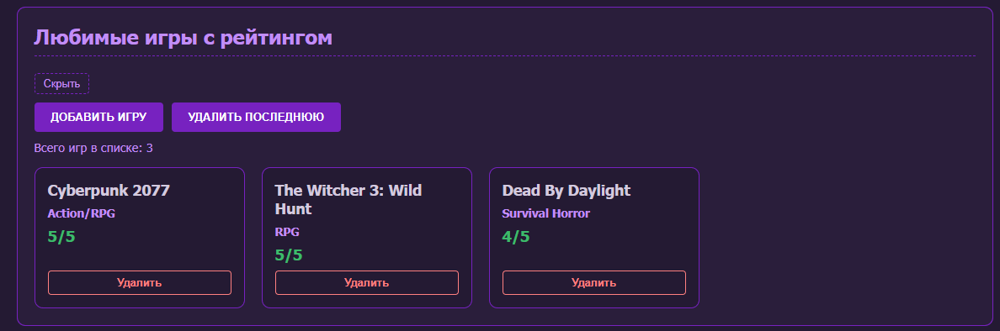
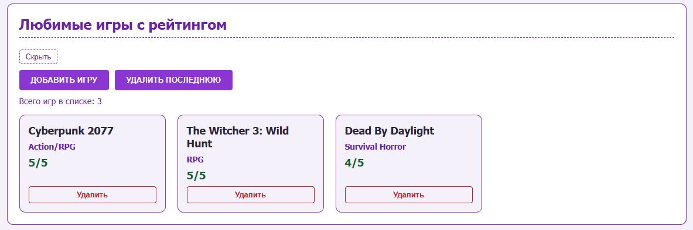
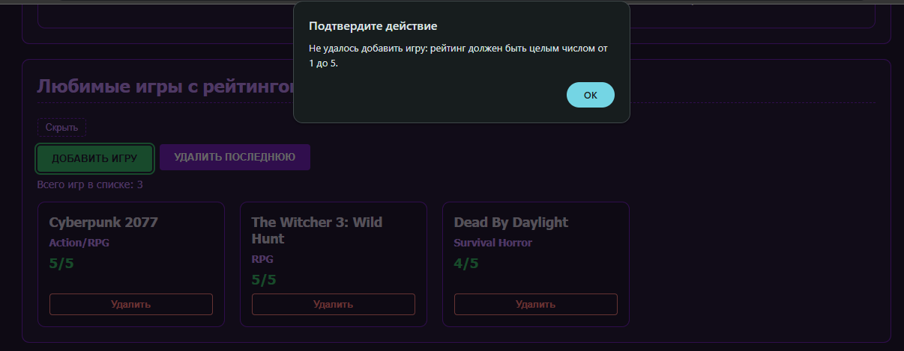

# Лабораторная работа №5. DOM и взаимодействие с элементами страницы
Выполнил Прикуль Александр Группа 932404

## Описание проекта
Данный проект является продолжением лабораторных работ №1-4. В script.js добавлены интерактивные возможности: манипуляции с DOM (создание и удаление карточек игр, изменение текста, атрибутов и классов), переключение светлой и тёмной темы, скрытие и показ блоков, а также сохранение состояния страницы в localStorage

## Выбранный вариант
Вариант 5. Тема «Геймер и разработчик игр»

## Использованные технологии
* HTML5
* CSS3
* JavaScript

## Реализованные требования

1. **Поиск элементов:**
   * getElementById - поиск кнопок и контейнеров с проверкой существования
   * querySelector - последняя карточка при удалении, содержимое карточки при сохранении
   * querySelectorAll - счётчик игр, сохранение списка, кнопки скрытия блоков

2. **Манипуляции с DOM без перезагрузки:**
   * создание и удаление карточек игр (createElement, append, remove)
   * изменение текста (счётчик игр, подписи кнопок)
   * изменение атрибутов (data-theme у body, data-rating у карточек, data-target у кнопок скрытия)
   * изменение классов (hidden для скрытия блоков, game-card при создании)

3. **Интерактивность:**
   * кнопка «Добавить игру» запрашивает название, жанр и рейтинг (1-5), создаёт карточку
   * кнопка «Удалить последнюю» и кнопка «Удалить» на каждой карточке
   * переключение светлой и тёмной темы по кнопке
   * скрытие и показ блоков «Навыки», «Статистика» и «Игры» по клику

4. **Обработка ошибок:**
   * проверка существования элемента перед работой с ним
   * валидация ввода: пустое название или жанр, рейтинг вне диапазона 1-5

5. **Сохранение состояния в localStorage:**
   * список игр (ключ gamesList) и тема (ключ siteTheme) сохраняются при каждом изменении
   * при загрузке страницы список и тема восстанавливаются

## Примеры работы

Тёмная тема, стартовый список игр:

Светлая тема после переключения:

Ошибка валидации при добавлении игры с рейтингом вне диапазона 1-5:

